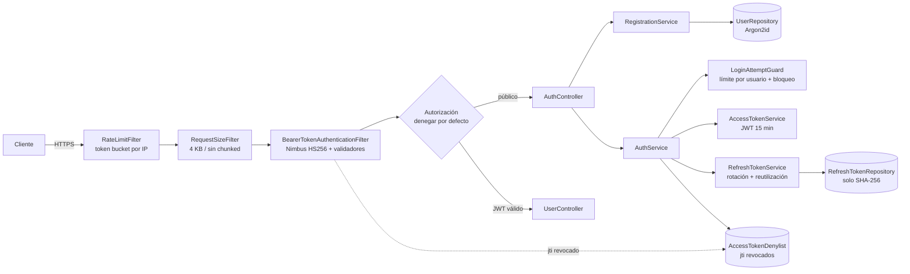

# auth-segura

API REST de **autenticación segura** desarrollada con asistencia de IA (Claude Code) como reto del
módulo 3, *Pruebas automatizadas y aseguramiento de la calidad*. Incluye validación con esquemas,
hash Argon2id, JWT con rotación de refresh tokens, rate limiting, una suite de 170 pruebas y un
pipeline CI/CD con cinco security gates.

| Indicador | Resultado | Evidencia |
|---|---|---|
| Pruebas | **170 / 170** en verde (95 unitarias, 59 de seguridad, 16 de integración) | `docs/evidencia/logs/09-verify-final.log` |
| Cobertura de líneas / ramas (JaCoCo) | **99,6 %** (478/480) / **98,3 %** (114/116); el build falla bajo 90 % | `docs/evidencia/reportes/jacoco/index.html` |
| Mutation testing (PIT) | **98 %** (127/129 mutantes eliminados; 2 equivalentes) | `docs/evidencia/reportes/pit/index.html` |
| Checkstyle | 0 violaciones | `09-verify-final.log` |
| SpotBugs + Find Security Bugs | 0 hallazgos (23 corregidos o justificados) | `01-spotbugs-gate-bloquea-23-hallazgos.log` |
| Trivy (dependencias) | 0 HIGH/CRITICAL (9 CVE corregidos al pasar a Spring Boot 4.1.2) | `02-…` y `04-trivy-final-0-vulnerabilidades.log` |
| Gitleaks (secretos) | 0 | `05-gitleaks-final-0-secretos.log` |

## Funcionalidad

| Método | Ruta | Acceso | Descripción |
|---|---|---|---|
| POST | `/api/auth/register` | público + rate limit | Alta de usuario (rol `USER` siempre) |
| POST | `/api/auth/login` | público + rate limit por IP y por usuario | Devuelve access token (15 min) y refresh token (7 días) |
| POST | `/api/auth/refresh` | público + rate limit | Rota el refresh token (un solo uso) y emite un access token nuevo |
| POST | `/api/auth/logout` | JWT | Revoca la familia del refresh token y el access token actual |
| GET | `/api/users/me` | JWT | Perfil del usuario autenticado |

## Requisitos

- **JDK 25** (por ejemplo Temurin 25). No hace falta Maven: el proyecto incluye el wrapper `mvnw`.
- `openssl` para generar el secreto (o cualquier generador de 32+ bytes aleatorios en Base64).

## Instalación y ejecución

La aplicación **no arranca sin `JWT_SECRET`** (Base64, mínimo 256 bits). Ningún secreto se versiona.

**Linux / macOS**

```bash
git clone https://github.com/<USUARIO>/auth-segura.git && cd auth-segura
export JWT_SECRET="$(openssl rand -base64 48)"
./mvnw verify            # Checkstyle + 170 pruebas + JaCoCo + SpotBugs/FindSecBugs
./mvnw spring-boot:run   # API en http://localhost:8081
```

**Windows (PowerShell)**

```powershell
git clone https://github.com/<USUARIO>/auth-segura.git; cd auth-segura
$bytes = New-Object byte[] 48; [Security.Cryptography.RandomNumberGenerator]::Fill($bytes)
$env:JWT_SECRET = [Convert]::ToBase64String($bytes)
.\mvnw.cmd verify
.\mvnw.cmd spring-boot:run
```

Comandos adicionales:

```bash
./mvnw test                                                   # solo pruebas
./mvnw test-compile org.pitest:pitest-maven:mutationCoverage  # mutation testing (target/pit-reports)
java -jar target/auth-segura-0.1.0.jar                        # ejecutar el jar empaquetado
```

### Variables de entorno y configuración

| Variable / propiedad | Valor por defecto | Descripción |
|---|---|---|
| `JWT_SECRET` | *(obligatoria)* | Clave HMAC-SHA256 en Base64, ≥ 32 bytes |
| `auth.jwt.access-token-ttl` | `15m` | Vigencia del access token |
| `auth.jwt.refresh-token-ttl` | `7d` | Vigencia del refresh token |
| `auth.rate-limit.ip-capacity` | `20` por minuto | Peticiones por IP a `/api/auth/**` |
| `auth.rate-limit.login-capacity` | `5` por minuto | Intentos de login por usuario |
| `auth.lockout.max-failed-attempts` | `5` | Fallos que bloquean la cuenta 15 minutos |
| `auth.http.cors-allowed-origins` | `http://localhost:5173` | Orígenes permitidos (nunca `*`) |
| `auth.http.max-body-bytes` | `4096` | Tamaño máximo del cuerpo (413 si se excede) |

Cualquier propiedad puede sobrescribirse con variables de entorno (`AUTH_LOCKOUT_MAX_FAILED_ATTEMPTS=10`).

## Ejemplos de uso (curl)

```bash
B=http://localhost:8081
read -rsp 'Contraseña (12 a 128 caracteres): ' PASSWORD; echo   # nunca escribas contraseñas en la documentación
# Registro
curl -s -X POST $B/api/auth/register -H 'Content-Type: application/json' \
  -d "{\"username\":\"eber\",\"email\":\"eber@ejemplo.com\",\"displayName\":\"Eber Silva\",\"password\":\"$PASSWORD\"}"
# Login -> {"accessToken":"eyJ…","tokenType":"Bearer","expiresIn":900,"refreshToken":"…","refreshExpiresIn":604800}
TOKENS=$(curl -s -X POST $B/api/auth/login -H 'Content-Type: application/json' \
  -d "{\"username\":\"eber\",\"password\":\"$PASSWORD\"}")
AT=$(echo "$TOKENS" | python3 -c 'import sys,json;print(json.load(sys.stdin)["accessToken"])')
RT=$(echo "$TOKENS" | python3 -c 'import sys,json;print(json.load(sys.stdin)["refreshToken"])')
# Perfil
curl -s $B/api/users/me -H "Authorization: Bearer $AT"
# Renovar (el refresh anterior deja de servir)
curl -s -X POST $B/api/auth/refresh -H 'Content-Type: application/json' -d "{\"refreshToken\":\"$RT\"}"
```

Errores en formato RFC 9457 (`application/problem+json`):

```json
{"type":"about:blank","title":"Bad Request","status":400,"detail":"La solicitud contiene datos inválidos",
 "instance":"/api/auth/register","errors":[{"field":"displayName","message":"debe tener de 1 a 60 caracteres: …"}]}
```

La salida completa de una sesión real, con los ataques incluidos, está en
`docs/evidencia/logs/07-demo-curl-api-real.txt`.

## Arquitectura



| Paquete | Contenido |
|---|---|
| `auth` | Casos de uso, DTOs con esquema, tokens, política de contraseñas |
| `user` | Entidad `User`, repositorio y `/api/users/me` |
| `ratelimit` | `RateLimiter` (token bucket), filtro por IP y configuración |
| `security` | Validadores JWT, lista de revocación, filtros y manejadores 401/403 |
| `config` | `SecurityFilterChain`, JWT, Argon2id y propiedades tipadas |
| `common` | Errores RFC 9457 y sanitización de logs |

## Seguridad

Resumen de controles. El modelo de amenazas completo está en [SECURITY.md](SECURITY.md).

- **Validación con esquemas**: DTOs `record` con Bean Validation y allowlists; propiedades JSON
  desconocidas rechazadas (sin mass assignment); cuerpos de más de 4 KB rechazados.
- **Contraseñas**: Argon2id (19 MiB, t=2, p=1), longitud de 12 a 128, lista de contraseñas
  comunes y prohibición de contener el usuario.
- **JWT**: HS256 exclusivamente (rechaza `alg=none`); valida firma, `exp` estricto, `nbf`, `iss`,
  `aud`, `sub`, `jti` e `iat`; revocación por `jti` en el logout.
- **Refresh tokens**: 256 bits aleatorios guardados como SHA-256, de un solo uso, rotados;
  si alguien reutiliza uno, se revoca toda la familia y se registra un evento de seguridad.
- **Rate limiting**: 20 peticiones por minuto por IP y 5 logins por minuto por usuario (429 con
  `Retry-After`); bloqueo de 15 minutos tras 5 fallos; respuestas idénticas y del mismo costo
  (hash ficticio) si el usuario no existe.
- **Cabeceras**: CSP `default-src 'none'`, HSTS, `nosniff`, `X-Frame-Options: DENY`,
  `Referrer-Policy`, `Permissions-Policy` y `Cache-Control: no-store`.

## Pruebas

| Tipo | Clases | Pruebas | Qué demuestran |
|---|---|---|---|
| Unitarias | 19 | 95 | Reglas de cada componente con Mockito y relojes controlables |
| Seguridad | 4 (`*SecurityTest`) | 59 | Inyección SQL, XSS, JWT manipulado, fuerza bruta, robo de refresh token, mass assignment, cabeceras y CORS |
| Integración | 3 | 16 | Flujo completo registro → login → perfil → refresh → logout, concurrencia y arranque sin secreto |

## Pipeline CI/CD

`.github/workflows/ci.yml` define cinco gates y un agregador (`security-gate`) que se configura
como check obligatorio de la rama `main`. El detalle de cada gate está en [docs/ci-cd.md](docs/ci-cd.md).

| Gate | Herramienta | Falla si… |
|---|---|---|
| 1. Build y calidad | `./mvnw verify`: Checkstyle, JUnit, JaCoCo, SpotBugs + FindSecBugs | violación de estilo, prueba fallida, cobertura < 90 % o cualquier hallazgo |
| 2. SAST | CodeQL `security-extended` | alerta de seguridad en el código |
| 3. Dependency review | `dependency-review-action` (PR) | dependencia nueva con CVE ≥ high o licencia GPL/AGPL |
| 4. Vulnerabilidades | Trivy fs (vuln, secret, misconfig) | CVE HIGH/CRITICAL con parche disponible |
| 5. Secretos | Gitleaks sobre todo el historial | cualquier secreto |

Además, Dependabot abre PRs semanales de Maven y de GitHub Actions.

## Desarrollo asistido por IA

- [CLAUDE.md](CLAUDE.md), [.cursorrules](.cursorrules) y
  [.github/copilot-instructions.md](.github/copilot-instructions.md): reglas de seguridad para
  Claude Code, Cursor y Copilot.
- [docs/prompts/](docs/prompts): plantilla de prompt seguro y los cinco prompts estructurados del proyecto.
- [docs/configuracion-ia.md](docs/configuracion-ia.md): cómo y por qué se configuró cada herramienta.
- [docs/evidencia/proceso.md](docs/evidencia/proceso.md): iteraciones, hallazgos, lecciones y reflexión.

## Estructura

```text
auth-segura/
├── .cursorrules, CLAUDE.md, .gitleaks.toml
├── .github/ (workflows/ci.yml, dependabot.yml, copilot-instructions.md)
├── config/ (checkstyle/, spotbugs/exclude.xml)
├── docs/ (ci-cd.md, configuracion-ia.md, prompts/, evidencia/{proceso.md, logs/, capturas/, reportes/})
├── src/main/java/com/equipo/auth/ (auth, user, ratelimit, security, config, common)
├── src/test/java/com/equipo/auth/ (unitarias, *SecurityTest, *IntegrationTest, support/)
├── README.md, SECURITY.md, CHANGELOG.md, pom.xml, mvnw
```

## Autor

Eber Silva Garcia (eber.silva@aden.com.mx) — Certificado en Desarrollo de software con IA Generativa, M3.
