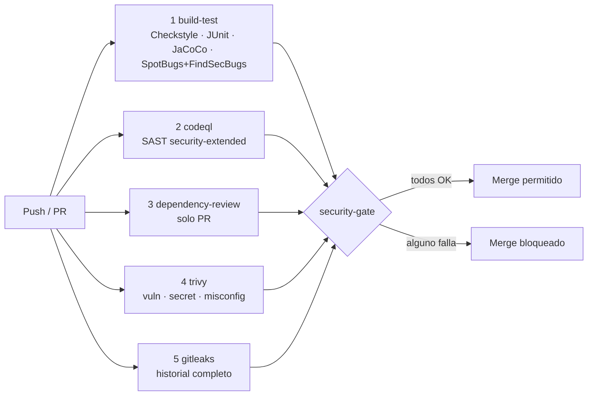

# Pipeline CI/CD y security gates

Archivo: `.github/workflows/ci.yml`. Se ejecuta en cada push y PR a `main`, cada lunes a las
06:00 UTC (para detectar CVE nuevas sin cambios de código) y de forma manual.

## Diseño



Los cinco gates corren **en paralelo**: el tiempo total es el del más lento y no la suma. El job
`security-gate` agrega los resultados y es el único check que se marca como obligatorio en la
protección de rama (*Settings → Branches → Require status checks → Security gate*).

## Gates y criterios de validación

| # | Gate | Herramienta y versión | Qué analiza | Criterio de falla | Resultado local |
|---|---|---|---|---|---|
| 1 | Build y calidad | Maven `verify`: Checkstyle 14.3.0, JUnit 5, JaCoCo 0.8.15, SpotBugs 4.10.5 + FindSecBugs 1.14.0 | Estilo, 170 pruebas, cobertura, bugs y patrones inseguros en bytecode | Cualquier violación, prueba fallida, cobertura de líneas o ramas < 90 % o cualquier hallazgo de SpotBugs (umbral `Low`) | 0 / 170 OK / 99,6 % – 98,3 % / 0 |
| 2 | SAST | CodeQL (`java-kotlin`, `security-extended`) | Flujo de datos fuente → sumidero (inyección, deserialización, criptografía débil…) | Alerta de seguridad; los resultados quedan en *Security → Code scanning* | No ejecutable fuera de GitHub |
| 3 | Dependency scanning | `actions/dependency-review-action@v4` | Diferencias de dependencias del PR | Dependencia nueva con CVE ≥ high o licencia GPL-3.0/AGPL-3.0 | No ejecutable fuera de un PR |
| 4 | Vulnerability scanning | Trivy 0.76.1 (`fs`) | `pom.xml` y transitivas, secretos y misconfiguraciones | HIGH/CRITICAL con parche disponible (`--ignore-unfixed`) | 9 CVE → 0 tras Spring Boot 4.1.2 |
| 5 | Secret scanning | Gitleaks v8.30.1 (`git`, `fetch-depth: 0`) | Todo el historial de commits | Cualquier secreto | 9 falsos positivos → 0 con `.gitleaks.toml` |
| — | Mantenimiento | Dependabot (Maven y Actions, semanal) | Versiones y advisories | — (abre PR que pasa por los gates) | — |

`actionlint 1.7.12` validó la sintaxis del workflow sin errores (`docs/evidencia/logs/06-actionlint-workflow.log`).

## Configuración optimizada

- **Mínimo privilegio**: `permissions: contents: read` global; `security-events: write` solo en
  los jobs que suben SARIF y `pull-requests: write` solo en Dependency Review.
- **Caché** de `~/.m2` con `actions/setup-java` (`cache: maven`) y `-ntp` para logs limpios.
- **`concurrency`** cancela ejecuciones viejas de la misma rama.
- **Imágenes fijadas** (`aquasec/trivy:0.76.1`, `zricethezav/gitleaks:v8.30.1`), sin `curl | bash`.
  Dependabot actualiza las acciones.
- **SARIF de Trivy** en la pestaña Security, aunque el gate falle (`if: always()`).
- **Reportes** de JaCoCo, SpotBugs y Surefire como artefacto durante 14 días.
- **Ejecución semanal** programada: una CVE publicada hoy rompe el build el lunes aunque nadie
  haya tocado el código.

## Exclusiones justificadas

Ninguna regla se desactiva de forma global. Cada exclusión apunta a una clase y un patrón, y tiene
una prueba que demuestra que el riesgo está mitigado.

| Herramienta | Exclusión | Justificación | Prueba |
|---|---|---|---|
| FindSecBugs | `SPRING_CSRF_PROTECTION_DISABLED` en `SecurityConfig` | API stateless con bearer token; no hay cookies | `cors_origenNoPermitido_esRechazado` |
| FindSecBugs | `XSS_SERVLET` en `ProblemJson` | Escribe JSON y escapa `< > & " \` y caracteres de control | `ProblemJsonTest`, `xss_enRutaReflejadaEnError_seEscapa` |
| FindSecBugs | `SPRING_ENDPOINT` en los dos controladores | Es un inventario, no una vulnerabilidad; endpoints revisados | `SecurityConfig` deniega por defecto |
| FindSecBugs | `SERVLET_HEADER` en el entry point y el filtro de tamaño | Solo se verifica si la cabecera existe | `FiltersAndEntryPointTest` |
| Gitleaks | `target/` | Salida de compilación, en `.gitignore` | — |
| Gitleaks | `SECURITY refresh_token_reuse user=<uuid> family=<uuid>` | Son UUID, no secretos | — |
| Gitleaks | `// gitleaks:allow` en la lista de contraseñas comunes y la contraseña ficticia de pruebas | Datos públicos o de prueba | — |

## Cómo reproducir los gates en local (sin GitHub)

```bash
export JAVA_HOME=/ruta/a/jdk-25
./mvnw verify                                                     # gate 1
podman run --rm -v "$PWD:/src:ro,Z" -v ~/.m2:/root/.m2:ro,z \
  docker.io/aquasec/trivy:0.76.1 fs --scanners vuln,secret,misconfig \
  --severity HIGH,CRITICAL --ignore-unfixed --skip-dirs /src/target --exit-code 1 /src   # gate 4
podman run --rm -v "$PWD:/repo:ro,Z" docker.io/zricethezav/gitleaks:v8.30.1 \
  git /repo --redact --exit-code 1                                 # gate 5 (requiere commits)
podman run --rm -v "$PWD:/repo:ro,Z" -w /repo docker.io/rhysd/actionlint:1.7.12   # sintaxis del workflow
```

> Montar `~/.m2` en Trivy evita el error `429 Too Many Requests` de Maven Central, que apareció en la
> primera ejecución local (el propio Trivy lo recomienda).
